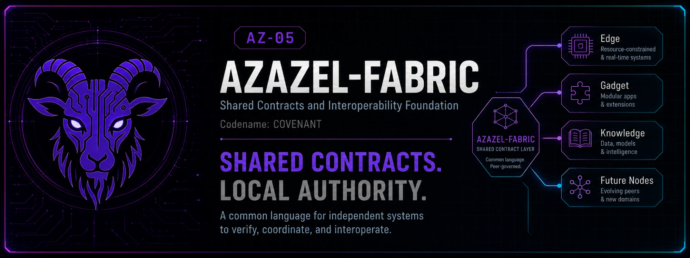

# AZ-05 Azazel-Fabric - Shared Contracts and Interoperability Foundation

> **Codename:** `COVENANT`



Shared contracts and interoperability foundation for the Azazel System.

> Formal series name **Azazel-Fabric Contract** (**AZ-05**), ratified
> 2026-07-10; formerly **Azazel-Common**. The codename `COVENANT` follows the
> series convention (Edge: `SENTINEL`, Gadget: `TACMOD`, Deception: `THEATRE`):
> the binding agreement the series' products sign — used for changelogs and
> release names, never formal external naming.

Thin, shared contract package for the Azazel series (`Azazel-Edge`,
`Azazel-Gadget`, `Azazel-Knowledge`, `Azazel-Deception`, and future tools such
as `Azazel-Boot`).

Azazel-Fabric is not the decision core of any Azazel product. It is the
series' common language. Each product's own judgment stays in its own
repository: Edge owns deterministic decisions and enforcement, Knowledge
analyzes/advises, Gadget owns its local mode control, and Deception
materializes only Edge-approved environments.

## Status

**Latest stable release: `v0.10.0`** — additive over `v0.9.0`: the
experimental Knowledge Context request/response profile
(`azazel_fabric.knowledge_context`, Fabric#76) and the producer captures —
real Azazel-Edge and Azazel-Deception output — in `azazel_fabric.testing`
(Fabric#23). Its contract surface is `v0.10.0rc1`'s unchanged. Five families
are experimental and carry no compatibility promise. Open Knowledge Context
integrations (Knowledge#116, MIO#47, Nexus#402) are outside its guarantee; see
`CHANGELOG.md` `[0.10.0]`.

`v0.9.0` — the `v0.9.0rc1` … `v0.9.0rc6` contract
work made stable (outcome, effect, `DefensiveState`, and the stable deception
and engagement families), with four families experimental and no
compatibility promise for them. Upgrading from `v0.8.0` has one non-additive
change (a 32-level nesting limit on the directive guards, Fabric#23); see
`CHANGELOG.md` `[0.9.0]`. The first canonical AZ-06 deception-environment
contract baseline shipped in `v0.5.0`; `v0.6.0` and `v0.8.0` were additive.
See [release compatibility](docs/release-compatibility.md) for the supported
contract families and observed consumer pins.

Before `v0.9.0`, six **release candidates** were published; the first two are
summarised here. `v0.9.0rc1` adds
`azazel_fabric.outcome_contracts`, `azazel_fabric.provisioning_contracts`, and
`azazel_fabric.mio_contracts`; `v0.9.0rc2` adds the canonical `DefensiveState`
vocabulary (`azazel_fabric.schema.defensive_state`) and
`azazel_fabric.effect_contracts`, and changes no symbol released before it, so
a consumer already on `rc1` had no urgent reason to move. Candidates make no
stability promise; a consumer should pin a stable tag (`v0.10.0`, or
`v0.9.0` if it needs nothing added since) — see the consumer table below.

Stable `v0.5.0` also ships everything from `v0.4.0`:

- `azazel_fabric.schema` / `azazel_fabric.cti_contracts` — shared schema and advisory-only CTI contract.
- `azazel_fabric.view` — shared `StatusView` view model.
- `azazel_fabric.paths` — non-authoritative candidate-path hints and dry-run migration planning.
- `azazel_fabric.audit` — shared `AuditEvent` projection and JSONL formatters.
- `azazel_fabric.api` — framework-neutral fail-closed API helpers.
- `azazel_fabric.notify` — notification payloads/mappers; no network send.
- `azazel_fabric.testing` — shared factories and invariant assertions.

`v0.5.0` introduced `azazel_fabric.deception_contracts`:

- `DeceptionPackage`, `NarrativeManifest`, `NarrativeConsistencyReport`
- `HostCapabilities`, `RuntimeRequirements`, `DeploymentTier`
- `ImageManifest`, per-platform OCI digests, provenance/SBOM references
- `PlacementPlan` with explicit `descriptive_only` authority
- Edge-owned activation/transition/termination decision contracts
- environment event/outcome contracts
- static rejection of directive-bearing Fabric payloads
- unrepresentable unrestricted egress/production access in the canonical safety model

`v0.6.0` adds effectiveness observation and finite-state transition catalog
contracts; `v0.8.0` adds advisory-only engagement contracts (described under a
`v0.7.0` that was never tagged) and the canonical decision-envelope signing
helpers. All remain descriptive contracts:
a valid signature proves transport origin and integrity, never action authority.

See [`docs/deception-contracts.md`](docs/deception-contracts.md).

## Consumer status

| Product | Current status |
|---|---|
| Azazel-Edge (AZ-01) | Observed dependency pin: `v0.10.0rc1` (a candidate) in `requirements/fabric.txt`; its tests read Deception's producer captures. Fabric remains optional for baseline Edge runtime — the arbiter runs with none installed. |
| Azazel-Gadget (AZ-02) | Shipping Fabric integration; observed dependency pin: `v0.9.0` (stable) for StatusView, which meets its needs. AZ-06 compatibility remains a constrained future `gadget-lite` subset. |
| Azazel-Knowledge (AZ-04) | Observed API optional-dependency pin: `v0.10.0rc1` (a candidate); its tests read both producers' captures. Core remains dependency-minimal and advisory-only. |
| Azazel-Deception (AZ-06) | Observed dependency pin: `v0.10.0rc1` (a candidate); its tests read Edge's producer captures. Live exposure remains disabled by default. |
| Azazel-Boot (AZ-03) | Observed `fabric` optional-extra pin: `v0.9.0rc1` (a candidate), **last read 2026-09-20**; an image lock is still required before a Boot implementation release. |
| Azazel-Nexus (AZ-07) | **No declaration** (last read 2026-09-20). No longer documentation-only — it carries code (`src/azazel_nexus/`) with `dependencies = []` on purpose. Its absence here is a design choice, not an omission. |

Edge, Gadget, Knowledge and Deception were re-read on 2026-11-05 at `main`
(Edge `2ef3ea8`, Gadget `551e1af`, Knowledge `8b3f350`, Deception `b27c097`);
the three on `v0.10.0rc1` carry the contract surface `v0.10.0` makes stable. Boot and Nexus
were last read on 2026-09-20 (Boot `5ad2f2e`, Nexus `6831d8b`) and nothing
about them is claimed for `v0.10.0`;
[`docs/release-compatibility.md`](docs/release-compatibility.md) is the
authority for this table and carries the reasoning behind each row.

## Install

Stable consumers should use the latest compatible exact tag, currently:

```bash
pip install "azazel-fabric @ git+https://github.com/01rabbit/Azazel-Fabric.git@v0.10.0"
```

Consumers pin an exact tag for field deployment (see
[`docs/design-principles.md`](docs/design-principles.md) §6).

```python
from azazel_fabric.schema import StateSnapshot, DecisionExplanation
from azazel_fabric.cti_contracts import CtiContextResponse
from azazel_fabric.deception_contracts import (
    DeceptionPackage,
    HostCapabilities,
    PlacementPlan,
    EnvironmentActivationDecision,
)
from azazel_fabric.view import StatusView, build_status_view
from azazel_fabric.api import error_payload, role_allows, extract_token
from azazel_fabric.notify import NotificationEvent, to_ntfy_payload
from azazel_fabric.paths import candidate_runtime_dirs, plan_migration
from azazel_fabric.audit import project_audit_event, to_jsonl_line
from azazel_fabric.testing import make_status_view, assert_advisory_only
```

Adopting Fabric in a new series product? Start with the
[day-1 adoption guide](docs/adoption-guide.md).

## Authority rule for AZ-06

> Fabric describes. Edge decides and enforces. Deception Host materializes,
> transitions, records, and resets. Knowledge analyzes and advises.

Capability reports, packages, placement plans, and advisories never grant
activation authority. In the initial architecture only an explicit,
unexpired Azazel-Edge decision may authorize an AZ-06 live runtime change.

## Versioning

Version management is tag-driven on GitHub. The single source of truth is
`src/azazel_fabric/version.py`; each release is a `vX.Y.Z` git tag plus a
matching GitHub Release, and a `vX.Y.ZrcN` tag is a pinnable candidate that
makes no stability promise. A `.dev0` value on `main` is explicitly unreleased.
The Release workflow validates that a pushed tag matches the packaged version
and runs the test suite before publishing. A releasable (non-`.dev`) version
additionally carries `release/v<version>.digest.json`, a reproducible sha256
manifest of the packaged surface generated by `tools/rc_digest.py` and enforced
by `tests/test_release_candidate_digest.py`.

## Documentation

| Document | Contents |
|---|---|
| [`docs/architecture.md`](docs/architecture.md) | Azazel-Fabric's position in the series and responsibility boundaries |
| [`docs/design-principles.md`](docs/design-principles.md) | What goes in Fabric vs. what never does, and why |
| [`docs/contracts.md`](docs/contracts.md) | Stable shared schema and Edge/Gadget ↔ CTI contracts |
| [`docs/deception-contracts.md`](docs/deception-contracts.md) | Canonical AZ-06 contract family (`v0.5.0`), authority and migration rules |
| [`docs/release-signing.md`](docs/release-signing.md) | R1b: how a release-candidate digest is signed (Ed25519, detached) and verified |
| [`docs/provisioning-contracts.md`](docs/provisioning-contracts.md) | Provisioning and M.I.O. contract families (R1a), authority rules, feature-to-minimum-version matrix |
| [`docs/release-compatibility.md`](docs/release-compatibility.md) | Current release truth, supported contract families, and observed consumer pins |
| [`docs/adoption-guide.md`](docs/adoption-guide.md) | Day-1 adoption playbook for a series product |
| [`docs/migration-plan.md`](docs/migration-plan.md) | Phased, additive, reversible rollout plan |
| [`docs/repository-layout.md`](docs/repository-layout.md) | Package layout |
| [`docs/issue-breakdown.md`](docs/issue-breakdown.md) | GitHub implementation work |

## License

MIT. See [`LICENSE`](LICENSE).
